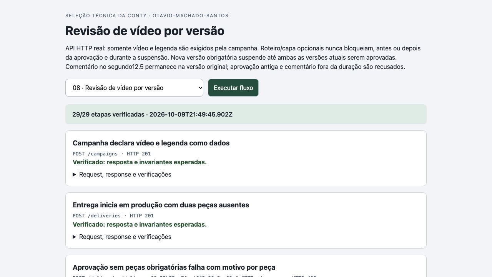
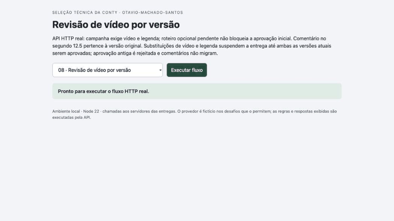

# Verificação final da entrega 8

Código revisado: `7cf5c6343987f501f45f760984dbc2e126adb06e`. Runtime: Node.js 22.23.3 em macOS.

Implementação e documentação: Codex. Revisão: dois agentes Codex independentes do implementador. Não houve revisão humana do código.

- 27 testes passaram no código final; [checkout isolado](evidence/coordenador-clone-limpo.txt).
- [Parecer A](reviews/08-a.json) e [parecer B](reviews/08-b.json), com sondagens independentes, limites e sugestões.
- [Transcrição HTTP real](evidence/coordenador-http.json): 29 etapas verificadas, com requests, respostas e invariantes.
- [Screenshot](evidence/screen.jpg), [resposta expandida](evidence/response.jpg) e [GIF da execução real](evidence/flow.gif).

O GIF foi codificado dos frames de screencast do navegador durante a execução das chamadas locais; não é uma montagem ou simulação. Os dados são fictícios. O portal apenas apresenta respostas da API e compara invariantes. Os limites de persistência, autenticação e operação estão no README. Os testes e capturas não representam deploy ou funcionamento em produção.

## Ajuste após a primeira revisão do Opus

O Opus pediu que peça não exigida pela campanha não bloqueasse também depois da aprovação. A política agora usa exclusivamente `campaign.requiredPieces`. Inclusão e substituição de roteiro, capa ou outra peça opcional nunca bloqueiam; versão nova obrigatória suspende até a versão atual ser aprovada. Não existe conjunto histórico de opcionais a revisar. Duas novas revisões Codex, 27 testes em checkout isolado e 29 etapas HTTP reais conferiram a correção, incluindo opcionais durante a suspensão e duas obrigatórias substituídas. Comentários continuam presos à versão e ao segundo original.

A nota original registrada na Conty descrevia a interpretação anterior de opcionais depois da aprovação. O recibo foi preservado; o README atual e [a nota da correção](correcao-pecas-opcionais.md) explicam a mudança feita após o pedido do Opus. A reavaliação pelo Opus será registrada separadamente após a publicação deste ajuste.

## Registro na Conty

Status observado: **Entrega registrada**, em 2026-10-09T19:46:42.120Z.

- [Link enviado](https://github.com/Otavio-Machado-Santos/conty-revisao-video).
- [Página do desafio](https://challenge.appconty.com/desafios/revisao-video).
- [Recibo e texto persistidos](evidence/conty-recibo.json).
- [Screenshot real do registro](evidence/conty-recibo.jpg).

O registro confirma o envio do link; a avaliação da Conty e o ranking dependem da auditoria da organização. Não é uma aprovação técnica pelo avaliador.
